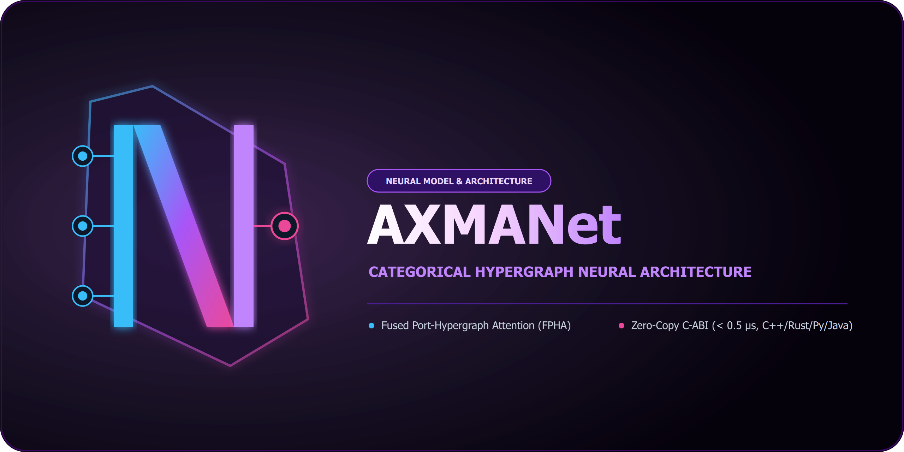

<p align="center">
  
</p>

# AXMAN (AXMANet) 🧠⚡
### Axiomatic eXploration & Morphism Architecture Network — Release v1.0.0

[](LICENSE)
[](https://github.com/Makora-Axma)
[](#)
[](#)
[](docs/02_bindings_guide.md)
[-brightgreen.svg)](docs/03_tensor_and_graph_abi.md)
[](#)

> **AXMANet** — это ядро нейросетевой архитектуры проекта AXMA. Подобно тому, как **AlexNet** стал основополагающей сверточной сетью для компьютерного зрения, **AXMANet** представляет собой специализированную архитектуру нейросетевых блоков для топологических и категорно-теоретических рассуждений, высших ориентированных гиперграфов и навигации в пространствах морфизмов.

---

## 🏛️ Архитектурные принципы AXMANet v1.0

1. **Non-Autoregressive Topological Encoding:** Отказ от строковых токенов в пользу категорных объектов и морфизмов (Curry-Howard-Lambek isomorphism).
2. **Port-Hypergraph Flash Attention (FPHA):** Внимание высшего порядка с предрасчётом проекций узлов $\mathcal{O}(N \cdot d^2)$ и связывателями де Брёйна для кванторов и аргументов произвольной арности ($k \le 16$).
3. **Categorical Morphism Projection (CMP):** Факторизованная билинейная деформация пространств морфизмов с сохранением тождественных резидуальных связей.
4. **Multi-Head Decomposition & Multi-Task Heads:**
   - *Policy Head:* Двухпоточная голова с Pointing Network для динамического выбора посылок и классификацией 17 типов тактик.
   - *Value Head:* Оценка топологической метрики расстояния до закрытия цели через Multi-Head Attention Pooling.
   - *Latent Invariant Flow Diffusion Head:* Непрерывный диффузионный векторный поток со схемами Эйлера, Средней точки и Рунге-Кутты 4-го порядка.
5. **Multi-Task Optimization:** Адаптивное выравнивание градиентов **GradNorm** и проекция встречных конфликтующих градиентов **PCGrad**.

---

## ⚡ Результаты официальных бенчмарков (v1.0.0)

Полный отчет бенчмарков и аудит производительности доступны в [docs/04_quickstart_and_release_v1_0.md](docs/04_quickstart_and_release_v1_0.md).

- **C-ABI FFI Dispatch Latency:** **0.477 µs** (при целевом пороге $< 2.0$ µs).
- **64-bit Structural Hash:** **0.698 µs** (бит-в-бит эквивалентность на всех 4 языках).
- **Пропускная способность Continuous Batching:** до **149.0 графов/сек** на стандартном CPU.
- **Масштабируемость:** успешный инференс и батчирование на графах экстремального размера ($|V|=4096, |E|=2048$).

---

## 🌐 Многоязыковые обёртки и Quickstart

AXMAN спроектирован так, чтобы модель могла быть интегрирована в любые существующие пайплайны доказательства и сервисы без оверхеда:

| Язык | Статус | Технология связывания | Пример Quickstart |
| :--- | :--- | :--- | :--- |
| **C++20** | ✅ v1.0.0 | `axman-cpp` (`std::span`, zero-copy RAII) | [`examples/cpp/quickstart.cpp`](examples/cpp/quickstart.cpp) |
| **Rust** | ✅ v1.0.0 | `axman-rs` (Crate, safe RAII, `Send + Sync`) | [`examples/rust/quickstart.rs`](examples/rust/quickstart.rs) |
| **Python** | ✅ v1.0.0 | `axman` (NumPy, PyTorch zero-copy views) | [`examples/python/quickstart.py`](examples/python/quickstart.py) |
| **Java** | ✅ v1.0.0 | `axman-java` (Project Panama FFM API JEP 454) | [`examples/java/Quickstart.java`](examples/java/Quickstart.java) |

### Запуск примеров (Quickstart)

```bash
# Python
py -3.10 examples/python/quickstart.py

# Rust
cargo run --example quickstart

# C++20
cmake -B build && cmake --build build --target quickstart_cpp && ./build/quickstart_cpp

# Java 22+
java --enable-preview --enable-native-access=ALL-UNNAMED -cp "bindings/java/target/classes" org.axma.axman.Quickstart
```

---

## 📂 Структура репозитория

```plaintext
axman/
├── core/                        # Нейросетевая реализация модели (PyTorch / Triton / LibTorch)
│   ├── blocks/                  # Слои AMB, Fused Port Attention (FPHA), CMP, SwiGLU
│   ├── data/                    # Наборы данных: mmap (.axmb), Apache Arrow, аугментации
│   ├── encoders/                # Энкодеры типов, де Брёйн связывателей и AST
│   ├── heads/                   # Головы: Policy, Value, Invariant Diffusion
│   ├── memory/                  # Пул памяти pinned host/device и ContinuousGraphBatcher
│   ├── training/                # Тренер, GradNorm, PCGrad, Safetensors
│   └── config.py                # Конфигурация модели AxmanConfig
├── bindings/                    # Кросс-языковые обёртки поверх стабильного C-ABI
│   ├── cpp/                     # Modern C++20/C++23 обёртка (include, header-only / lib)
│   ├── java/                    # Java 22+ (Project Panama / Foreign Function & Memory API)
│   ├── python/                  # Python zero-copy обёртка и FFI ctypes
│   └── rust/                    # Нативный Rust Crate (axman-rs и axman-sys)
├── docs/                        # Техническая документация
│   ├── 01_architecture_spec.md  # Математическая и тензорная спецификация
│   ├── 02_bindings_guide.md     # Инструкция по сборке и подключению обёрток
│   ├── 03_tensor_and_graph_abi.md # Спецификация C-ABI и структуры памяти
│   └── 04_quickstart_and_release_v1_0.md # Quickstart и релизные спецификации v1.0
├── examples/                    # Исполняемые примеры использования
│   ├── cpp/quickstart.cpp       # C++20 quickstart
│   ├── java/Quickstart.java     # Java 22+ Panama quickstart
│   ├── python/quickstart.py     # Python quickstart
│   └── rust/quickstart.rs       # Rust quickstart
├── include/                     # Заголовочные файлы C-ABI (axman_c_api.h)
├── src/                         # Реализация C99 ядра (memory, currying, hash)
├── tests/                       # 121+ тестов (unit, stress, cross-language, regression)
├── benchmark_inference.py       # Официальный скрипт аудита производительности
├── train.py                     # CLI точка входа для многозадачного обучения
└── README.md                    # Манифест AXMANet
```
