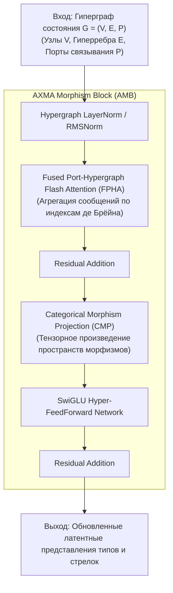

# AXMAN (AXMANet): Архитектурная спецификация блока и модели

## 1. Концепция AXMANet

**AXMANet (Axiomatic eXploration & Morphism Architecture Network)** — это фундаментальная нейросетевая архитектура, спроектированная специально для работы с категориями типов, ориентированными гиперграфами и пространствами морфизмов. Подобно тому, как *AlexNet* стал эталонной сверточной сетью для компьютерного зрения, а *Transformer* — для одномерных последовательностей, **AXMANet** выступает эталонной моделью для топологических и категорных рассуждений.

---

## 2. Анатомия базового блока AXMAN Block

Базовый строительный блок модели — **AXMA Morphism Block (AMB)**:

### Математическая формулировка слоя:
1. **Портовое гиперграфовое внимание (Port-Hypergraph Attention):**
   Пусть $v \in V$ — объект (тип), а $e = (u_1, \dots, u_k) \to v$ — морфизм ранга $k$ с портами $p \in \{0, \dots, k-1\}$.
   Внимание вычисляется с учетом относительной позиции аргумента в сигнатуре:
   $$\text{Attn}(v, e) = \text{Softmax}\left(\frac{(Q v) \cdot (K [e \,\|\, \text{Emb}(p)])^\top}{\sqrt{d}}\right) V [e \,\|\, \text{Emb}(p)]$$
2. **Инвариантность и эквивариантность:**
   Блок строго инвариантен к изоморфизмам графов типов и переименованиям несвязанных переменных, но эквивариантен к порядку следования типизированных аргументов.

---

## 3. Модельные головы (Model Heads)

AXMANet предоставляет три специализированные головы:
1. **Morphism Policy Head:** Предиктор допустимых тактических переходов и выбора лемм (Premise Selection).
2. **Distance-to-Closure Value Head:** Скалярная оценка расстояния до завершения доказательства (Q.E.D.) на базе топологической сложности.
3. **Latent Invariant Diffusion Head:** Диффузионный генератор промежуточных представлений для синтеза вспомогательных лемм.

---

## 4. Требования к реализации

- Непрерывный C-ABI интерфейс для нулевого оверхеда при трансляции тензоров в другие языки.
- Полная изоляция логики модели от верификаторов: модель принимает структурированный граф тензоров и возвращает вероятности/вектора латентных морфизмов.
