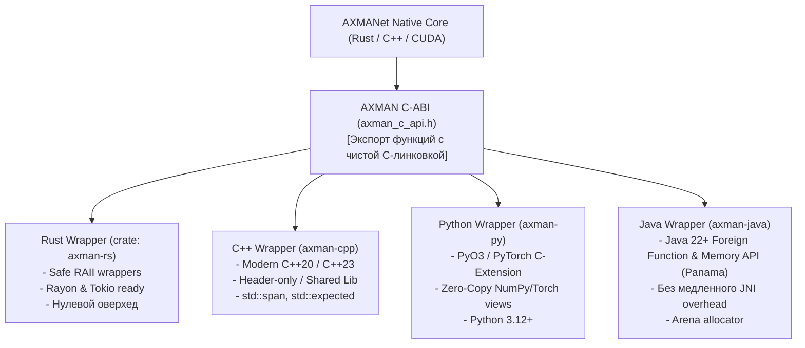

# Руководство по многоязыковым обёрткам AXMANet (Bindings Guide)

Для обеспечения максимальной переносимости и гибкости ядро **AXMANet** экспортирует стандартизированный **C-ABI (Application Binary Interface)** с нулевым оверхедом по памяти, поверх которого построены нативные обёртки для четырёх ключевых языков: **C++**, **Java**, **Python**, и **Rust**.

---

## 1. Архитектура межлингвистического взаимодействия



---

## 2. Спецификация обёрток по языкам

### 2.1. Rust (`axman/bindings/rust/`)
* **Механизм:** Нативный Crate с автоматической генерацией привязок через `bindgen` или прямая реализация на Rust.
* **Использование:**
```rust
use axman::{AxmanModel, HypergraphState, ModelConfig};

let config = ModelConfig::default().with_dim(512).with_layers(12);
let model = AxmanModel::load_weights("weights.safetensors", config)?;

let state = HypergraphState::from_tactic_context(&context)?;
let output = model.forward(&state)?;
println!("Predicted morphism prior: {:?}", output.policy);
```

### 2.2. Modern C++ (`axman/bindings/cpp/`)
* **Механизм:** C++20 обёртка над C-ABI.
* **Использование:**
```cpp
#include <axman/axman.hpp>

axman::Config config{.hidden_dim = 512, .num_layers = 12};
axman::Model model("weights.safetensors", config);

auto graph = axman::Hypergraph::build(raw_nodes, raw_edges);
axman::InferenceResult res = model.forward(graph);
```

### 2.3. Python (`axman/bindings/python/`)
* **Механизм:** Высокопроизводительный модуль на `PyO3` с прямой интеграцией в тензоры PyTorch (`torch.Tensor`).
* **Использование:**
```python
import torch
import axman

model = axman.AxmanNet.from_pretrained("weights.safetensors")
# Прием PyG графа или батча с нулевым копированием
output = model(graph_batch)
policy_logits = output.policy_logits
value_estimate = output.value
```

### 2.4. Java (`axman/bindings/java/`)
* **Механизм:** Современный **Project Panama (Foreign Function & Memory API, JEP 454)**, встроенный в OpenJDK 22+. Отказ от устаревшего и медленного JNI в пользу прямого `Linker.nativeLinker()` и детерминированных сегментов памяти `Arena.ofConfined()`.
* **Использование:**
```java
try (var arena = Arena.ofConfined()) {
    var model = new AxmanModel("weights.safetensors", arena);
    var graph = Hypergraph.create(arena, nodes, edges);
    var result = model.forward(graph);
    System.out.println("Predicted value: " + result.getValue());
}
```
